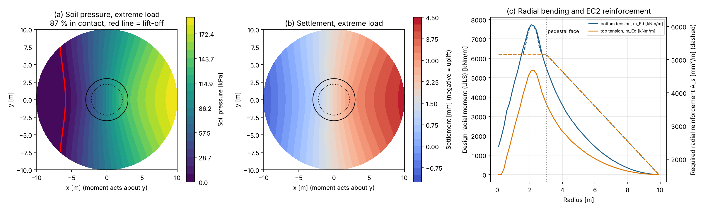
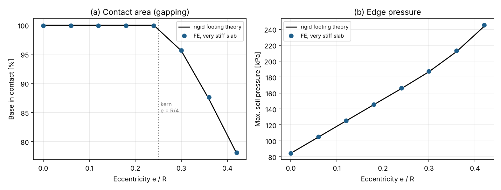
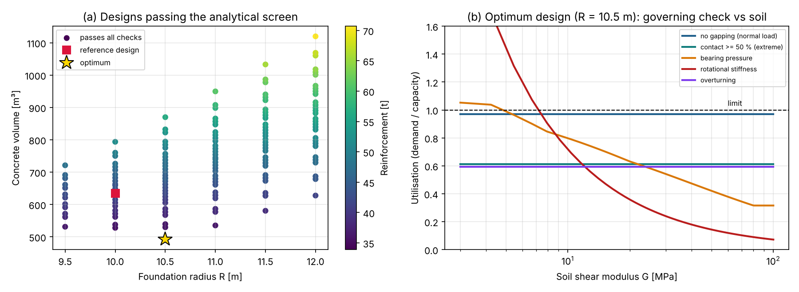

# Wind Turbine Gravity Foundation: FE Soil–Structure Interaction, Eurocode 2 Design and Optimisation

A Python design tool for the reinforced-concrete gravity foundation of an onshore wind turbine. It combines:

- **FE soil–structure interaction**: a Reissner–Mindlin plate of variable thickness on tension-less soil, so the foundation can **lift off (gapping)** under extreme wind.
- **Classical stability checks**: gapping, effective-area bearing pressure, rotational stiffness, overturning and sliding.
- **Eurocode 2 reinforced-concrete design**: bending, shear and minimum reinforcement, plus the load transfer from the **anchor cage ("foundation basket")**.
- **Automated parametric study and optimisation**: finds the lightest foundation that passes every check, and shows how the governing check changes with the soil.

Built with open-source tools (Python, scikit-fem, Triangle). A guide for building the same model in 3D in **ANSYS Mechanical** (frictional contact, Mohr–Coulomb soil, REINF264 reinforcement, PyAnsys automation) is in [`ansys/ANSYS_Mechanical_steps.md`](ansys/ANSYS_Mechanical_steps.md).



## Problem

| | |
|---|---|
| Turbine | 4–5 MW class, about 120 m hub height. Assumed characteristic tower-base loads: N = 5 000 kN; extreme M = 90 MNm and H = 1.2 MN; normal production M = 55 MNm and H = 0.8 MN |
| Foundation | Circular slab with a conical top and a central pedestal holding the anchor cage (bolt circle radius 2.2 m), covered with backfill |
| Reference design | R = 10 m (20 m diameter), 1.0 m edge, 3.2 m at the pedestal: 634 m³ of concrete |
| Materials | Concrete C35/45, reinforcement B500B |
| Soil (reference) | Medium-dense sand: G = 50 MPa, ν = 0.3, allowable bearing pressure 300 kPa |
| ULS factor | γ_F = 1.35 on the loads for reinforcement design; 0.9 on favourable self-weight for overturning |

### Design criteria

| Check | Criterion |
|---|---|
| Gapping, normal production | No lift-off: eccentricity e = M/N ≤ R/4 (the kern of a circle) |
| Gapping, extreme load | At least 50 % of the base in contact |
| Bearing | Pressure on the effective (compressed) area ≤ allowable |
| Rotational stiffness | K ≥ 50 GNm/rad (assumed turbine requirement). Elastic half-space formula from the DNV/Risø (2002) guidelines |
| Overturning, sliding | Design stabilising action ≥ destabilising action |
| Bending (EC2 6.1, 9.2.1.1) | Required A_s at the pedestal face, with the minimum reinforcement 0.26 f_ctm/f_yk·b·d |
| Shear (EC2 6.2) | v_Ed ≤ v_Rd,c; otherwise shear links are designed (cot θ = 2.5) |
| Anchor cage (EC2 6.7) | Concrete pressure under the bottom anchor flange ≤ f_Rdu; hanger reinforcement for the uplift on the tension side |

## Method

1. **Analytical checks** (`src/foundation.py`): weights of the concrete and backfill, the rigid-footing contact solution on tension-less soil, and the effective-area bearing pressure. The stiffness check uses K = 8GR³/(3(1−ν)) with corrections for embedment and soil-layer depth.
2. **FE model** (`src/plate_fem.py`): Reissner–Mindlin plate with quadratic triangles (w, θx, θy) whose thickness follows the real profile.
   - The soil is modelled as Winkler springs calibrated to the elastic half-space stiffness.
   - The springs only push. The contact zone is found with an **active-set iteration**: springs switch off where the slab lifts.
   - The turbine loads enter through the anchor ring as N/(2πa) + M cos φ/(πa²).
3. **Design** (`src/design.py`): EC2 reinforcement along the radius for both faces and both directions, shear links where needed, hanger reinforcement for the anchor cage, and the concrete pressure under the anchor flange. It also calculates the steel mass.
4. **Optimisation** (`scripts/03_parametric_optimisation.py`): 270 combinations of R, edge thickness and pedestal thickness. A fast analytical screen runs first, then the full FE and EC2 design on each candidate that passes. The design with the least concrete wins.

## Results

### 1. Verification of the FE model

| Test | Result |
|---|---|
| Simply supported circular plate, uniform load, vs the analytical Mindlin solution | Error −0.24 % (1 m thick) and −0.14 % (3 m thick) at 0.6 m elements |
| Very stiff slab on tension-less soil vs rigid-footing theory (contact area, edge pressure, e/R = 0 to 0.42) | Contact within 0.3 %, edge pressure within 0.6 % |
| Mesh convergence, reference foundation (11 571 → 39 780 DOFs) | Peak soil pressure changes by 0.3 %, moment at the pedestal face by 0.1 % |



### 2. Reference foundation (R = 10 m)

| Quantity | Value |
|---|---|
| Concrete / backfill / total vertical load | 634 m³ / 315 m³ / 26 500 kN |
| Normal production | Full contact (e = 2.16 m < R/4 = 2.5 m) |
| Extreme load | 87 % of the base in contact (FE), 88 % (rigid theory) |
| Max soil pressure (FE) / effective-area pressure | 192 kPa / 151 kPa (allowable 300 kPa) |
| Rotational stiffness / FE tilt | 344 GNm/rad / 0.3 mrad |
| ULS radial moment at the pedestal face | 5 340 kNm/m → minimum reinforcement governs (5 160 mm²/m) |
| One-way shear at d from the pedestal | v_Ed = 803 > v_Rd,c = 656 kN/m → shear links between r = 3.1 and 6.9 m |
| Anchor flange bearing | 14.7 MPa ≤ f_Rdu = 34.4 MPa |
| Bolt tension on the windward side | ≈ 7 950 kN per metre of bolt circle → hanger reinforcement 4.4 t |
| Reinforcement estimate | 42 t (66 kg/m³) |

**The FE model shows what the rigid hand calculation misses.** The flexible slab spreads the edge pressure (192 instead of 209 kPa). On the windward side, the anchor cage pulls the slab up. This causes top-face tension of up to 5 400 kNm/m (ULS) around the anchor ring. Further out, about 2 200 kNm/m remains where the backfill presses down on a slab that has lost soil support. Both areas need top reinforcement, which a rigid-footing calculation does not reveal.

### 3. Optimisation: a material-efficient foundation



| Design | Radius | Edge / pedestal thickness | Concrete | Reinforcement | Governing check |
|---|---|---|---|---|---|
| Reference | 10.0 m | 1.0 / 3.2 m | 634 m³ | 42.1 t | – |
| **Optimum** | **10.5 m** | **0.6 / 2.4 m** | **492 m³ (−22 %)** | **33.9 t (−20 %)** | **no gapping under normal production (97 % used)** |

The optimum also has the lowest indicative cost. Its edge and pedestal thicknesses sit at the lower limits allowed in the study (0.6 m edge and 2.4 m pedestal, set by the anchor-cage length).

**Findings**

- **Gapping governs, not strength.** For this turbine, the no-gapping requirement under normal production sets the size of the foundation. Bearing pressure, overturning, bending and shear all have spare capacity.
- **Use backfill, not concrete, as ballast.** A slightly larger diameter with a thin, tapered slab carries more backfill weight. That keeps the resultant inside the kern with 22 % less concrete and 20 % less steel. This is the principle behind material-efficient foundation concepts.
- **Soil decides when gravity foundations stop working.** For the optimum design, rotational stiffness becomes governing below G ≈ 7 MPa and bearing pressure below about 5 MPa. On very soft clay (G = 4 MPa), no gravity foundation in the studied range is stiff enough. Ground improvement or piles would be needed.
- **Python automation pays off.** The full study (270 candidates, 155 complete FE and EC2 designs) runs in about 7 minutes on a laptop.

For comparison, a published 4.2 MW reference foundation (Li et al., 2024) uses an 18 m diameter, 515 m³ of concrete and 52 t of reinforcement. This model's quantities are of the same order. Its steel figure is lower because crack-width control, fatigue design and detailing reinforcement are not included.

## Limitations and next steps

- A plate model with Winkler springs, not a 3D continuum. The local stresses around the anchor cage need a 3D model, as described in the ANSYS guide.
- The tower loads are assumed, not taken from a turbine certificate. Torsion and dynamic loads are not included.
- EC2 checks covered: ULS bending, shear and partially loaded areas. Not yet covered: crack width (SLS, EC2 7.3), **fatigue of concrete and reinforcement** (EC2 6.8, critical for wind turbines) and the anchor-bolt fatigue and preload.
- Soil: linear elastic springs, and no settlement, consolidation or cyclic degradation.
- Next steps: a fatigue check with Markov load matrices, an octagonal shape, and a 3D ANSYS model driven by PyAnsys.

## Run it yourself

```bash
pip install -r requirements.txt
python scripts/01_validate.py                 # FE verification and mesh convergence (~30 s)
python scripts/02_reference_design.py         # full design of the reference foundation
python scripts/03_parametric_optimisation.py  # parametric study and optimisation (~7 min)
```

Change the loads, soil or criteria in `src/foundation.py` (`Loads`, `Soil`, `Criteria`).

## Project structure

```
src/foundation.py      geometry, loads, soil, rigid-footing contact, bearing, stiffness, EC2 formulas
src/plate_fem.py       Mindlin plate on tension-less Winkler soil (scikit-fem), active-set contact
src/design.py          complete design check: FE + EC2 reinforcement, shear links, anchor cage, steel mass
scripts/01_validate.py              verification against analytical solutions, mesh convergence
scripts/02_reference_design.py      reference foundation, figures
scripts/03_parametric_optimisation.py   parametric study, optimisation, soil sensitivity
ansys/ANSYS_Mechanical_steps.md     how to build the 3D model in ANSYS Mechanical
results/                            CSV tables and figures
```

## References

- EN 1992-1-1 (Eurocode 2): Design of concrete structures.
- IEC 61400-6:2020: Wind energy generation systems, Part 6: Tower and foundation design requirements.
- DNV/Risø (2002): Guidelines for Design of Wind Turbines, 2nd ed. (foundation stiffness).
- Li, J. et al. (2024): Design and analysis of a new prefabricated foundation for onshore wind turbines. *Buildings* 14(1), 193.
- Svensson, H. (2010): Design of foundations for wind turbines. Master's thesis, Lund University (TVSM-5173).

---

Muhammad Maaz Asmat · Mechanical Engineer, M.Sc. student in Sustainable Maritime Operations (Hochschule Emden/Leer)
